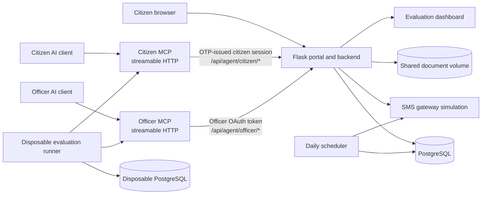

# Sewa Setu

Sewa Setu is a Flask and PostgreSQL old-age pension application portal with
separate citizen and officer MCP servers. The portal is the system of record:
the web portal and both MCP servers use its backend and the same database.

> This repository contains an application workflow and MCP integrations, not
> an LLM or an embedded chat UI. A connected MCP-compatible client supplies the
> AI model and its conversation handling.

## Contents

- [Overview](#overview)
- [Architecture](#architecture)
- [Quick start on Windows](#quick-start-on-windows)
- [Service URLs](#service-urls)
- [Citizen application workflow](#citizen-application-workflow)
- [MCP servers](#mcp-servers)
- [Configuration reference](#configuration-reference)
- [Business rules and limitations](#business-rules-and-limitations)
- [Evaluation dashboard and end-to-end evaluation](#evaluation-dashboard-and-end-to-end-evaluation)
- [Tests](#tests)
- [Operations and troubleshooting](#operations-and-troubleshooting)
- [Security and privacy](#security-and-privacy)
- [Repository layout](#repository-layout)
- [Project status and license](#project-status-and-license)

## Overview

| Component | Responsibility |
|---|---|
| Citizen portal | Mobile OTP sign-in, application form, document upload, review, submission, status, and withdrawal. |
| Flask backend | Shared application validation, database operations, OAuth authorization, citizen and officer API routes. |
| Citizen MCP | OTP-verified citizen tools for scheme information, resumable drafts, documents, submission, status, and withdrawal. |
| Officer MCP | Authenticated officer tools for application and document review, queue operations, audit notes, and decisions. |
| PostgreSQL | Stores applications, drafts, portal users, OAuth state, and audit records. |
| SMS gateway | Local in-memory SMS simulation used for OTPs and notifications; not an external telecom integration. |
| Scheduler | Runs the daily 15-day deemed-approval job and expired citizen-draft cleanup. |
| Evaluation dashboard and runner | Displays synthetic persona evaluations. The runner uses real streamable-HTTP MCP clients and checks database state. |

Citizen application and supported officer MCP operations use all blocks in
the portal's supported-block catalog: Sonari, Rajapara, Dhemaji Pathar,
Borgaon, Namti, and Khelua. The obsolete `MCP_ENABLED_BLOCKS` environment
setting is ignored, including a stale `MCP_ENABLED_BLOCKS=Sonari` value.
Unsupported block names are still rejected.

The repository does not contain an authoritative village-to-block registry.
Block names are checked, but village/block relationships are not verified.
Historical application rows are not treated as an authoritative mapping.

## Architecture



The citizen and officer servers have separate URLs and tool lists. Citizen
MCP transport is public, but every citizen-specific operation requires a
short-lived session issued only after OTP verification. Officer MCP remains
OAuth-protected with its own audience and scope. MCP requests are forwarded by
[`PortalClient`](./mcp_servers/common/portal_client.py) to the existing Flask
backend. They do not maintain another application database. The normal web
portal and MCP services share PostgreSQL and the document volume in Docker
Compose.

There is no CSC-specific application frontend or service in this repository.
No standalone LLM agent, model API configuration, or chat-history management
implementation is present; those belong to the client connected to MCP.

## Quick start on Windows

### Prerequisites

- Windows 10/11 with Docker Desktop installed and running.
- Docker Compose v2 (`docker compose`).
- PowerShell.
- For local Python tests: Python 3.11 is the version used by the project
  Dockerfiles.

The supported full-stack local setup is Docker Compose. A separately managed
manual Flask/MCP deployment is not documented as a supported alternative.

### Configure and start

From the project root:

```powershell
if (-not (Test-Path .env)) { Copy-Item .env.example .env }
notepad .env
```

Set unique, non-empty values for `DB_PASSWORD`, `ADMIN_PASSWORD`,
`SMS_GATEWAY_TOKEN`, and `SECRET_KEY`. `SECRET_KEY` and `SMS_GATEWAY_TOKEN`
must each be at least 32 characters. Generate a random value when needed:

```powershell
python -c "import secrets; print(secrets.token_hex(32))"
```

Run it separately for each secret; do not paste the generated values into
source control or share them. Keep the local `.env` private.

Start the services:

```powershell
docker compose up --build -d
docker compose ps
```

Check the portal and advertised MCP blocks:

```powershell
Invoke-WebRequest -UseBasicParsing http://localhost:8000/
Invoke-RestMethod http://localhost:8000/api/agent/scheme
```

The JSON response's `enabled_blocks` array is the backend's current supported
block catalog. For logs:

```powershell
docker compose logs --tail 100 app db citizen-mcp officer-mcp scheduler smsgw
docker compose logs -f app
```

The database container mounts `app/schema.sql` and `seed/seed.sql` as
PostgreSQL initialization scripts. PostgreSQL runs those scripts only when
initializing a **new, empty database volume**. Existing named volumes preserve
their records; changing the scripts does not re-run them. Do not remove
`pgdata` or use `docker compose down --volumes` against a database whose
records you want to keep. No separate migration command is provided.

Stop the services while preserving named volumes:

```powershell
docker compose down
```

### Connect an MCP client

After startup, use the citizen URL for a citizen identity and the officer URL
for an officer identity. The repository's VS Code example is
[`\.vscode\mcp.json`](./.vscode/mcp.json):

```json
{
  "servers": {
    "sewasetu-citizen": {
      "type": "http",
      "url": "http://localhost:8001/mcp"
    },
    "sewasetu-officer": {
      "type": "http",
      "url": "http://localhost:8002/mcp"
    }
  }
}
```

The MCP endpoints require OAuth; the JSON config only supplies server
addresses, not credentials. Complete sign-in and consent for the matching
resource when prompted by the MCP client. Never use an officer token with the
citizen endpoint or vice versa. The citizen MCP server does not expose
officer-only tools.

## Service URLs

| Service | Local URL | Notes |
|---|---|---|
| Citizen portal | <http://localhost:8000/> | Flask application. |
| Apply | <http://localhost:8000/apply> | Starts the web OTP and application workflow. |
| Status portal | <http://localhost:8000/status> | Applicant sign-in and application status. |
| Department admin | <http://localhost:8000/admin> | Requires `ADMIN_USERNAME` and `ADMIN_PASSWORD`. |
| Evaluation dashboard | <http://localhost:8000/eval-dashboard> | Displays the evaluation results file. |
| Citizen MCP | <http://localhost:8001/mcp> | Streamable HTTP; OTP-verified citizen sessions for personal operations. |
| Officer MCP | <http://localhost:8002/mcp> | Streamable HTTP; officer OAuth scope. |
| Scheme API | <http://localhost:8000/api/agent/scheme> | Public rules and supported-block response. |

PostgreSQL and the SMS gateway are internal Compose services; they are not
published as host ports. The redacted simulated SMS status console is publicly
available at `/__gateway/`. Department administrators see the full console at
that URL after sign-in; unauthenticated visitors see counts only. Inbox and
send operations require departmental admin authentication.

## Citizen application workflow

### Web portal

1. The applicant enters a mobile number and answers the portal's arithmetic
   check at `/apply`.
2. The portal stores and sends an OTP through the configured SMS gateway.
   The OTP expires after five minutes. Successful verification binds the web
   session to that mobile number.
3. The applicant completes the three form steps for personal, address, and
   bank details. Incomplete values remain in the web session.
4. The applicant uploads age proof as PDF, JPG, JPEG, or PNG, up to 5 MB. The
   portal checks the extension, file signature, readability, and stored file.
5. The declaration page validates and displays the application for review.
   The applicant must return to the review before final submission.
6. The backend validates the required fields, minimum age, supported block,
   bank/IFSC formats, open scheme window, proof path, and active-application
   rule before it creates the application, audit record, and application
   number.
7. The applicant can use the status portal to view the recorded status or
   withdraw their own pending application.

The web workflow permits one saved correction after the application has been
reviewed and before submission. A draft-state record in PostgreSQL prevents
reusing that edit opportunity. This rule is specific to the web workflow.

### Citizen MCP

1. Connect to Citizen MCP without OAuth. Call `request_citizen_otp`, then
   `verify_citizen_otp` with the code received on the citizen's mobile. OTP
   requests and verification attempts are rate-limited; verification is never
   skipped.
2. Successful verification automatically creates or resumes the citizen's
   draft. The MCP server keeps the actual short-lived portal `session_token`
   privately in its process and returns only an opaque `session_ref` for use
   with protected tools. Never display either credential in chat. The reference
   expires with the portal session and is lost if the Citizen MCP process
   restarts; citizens can request and verify a new OTP to continue.
3. Collect missing details in a labeled, one-question-at-a-time sequence and
   save each answer immediately with `save_application_draft`. The draft is
   associated with the verified session's mobile number, not a
   caller-supplied identity.
4. Request the actual age-proof file. `attach_age_proof` accepts actual bytes
   (base64 at the MCP tool boundary); it does not accept an inferred image or
   applicant-pasted document text. The backend checks file type, size,
   signature, readability, and storage.
5. Call `validate_age_proof`. The backend records `REVIEW_REQUIRED` after
   readability checks. This is **not** an authenticity or age decision.
6. An authorized officer uses the officer MCP tools to inspect the actual
   document and record a reasoned `VALID`, `INVALID`, or `REVIEW_REQUIRED`
   decision for the current document.
7. When the document is `VALID`, call `get_application_draft`, present its
   masked summary, and obtain explicit confirmation of the summary and
   declaration. Only then call `submit_pension_application`.
8. The citizen may call `check_my_application` for status or
   `get_my_application_slip` for the acknowledgment PDF.

MCP drafts preserve incomplete progress and can be resumed. Missing
information or a document does not require restarting the workflow. Inactive
incomplete drafts are purged after 30 days by default; this interval is
configurable. The web form has its own session-backed draft flow.

## MCP servers

Both servers use streamable HTTP and share the portal API and PostgreSQL
records. Citizen transport does not require OAuth; citizen-specific tools
require an opaque reference to the short-lived server-held session created
after mobile OTP verification. Officer
MCP and all officer actions continue to require an OAuth bearer token. The
backend checks token signature, issuer, audience, role, scope, and identity.
Tools are not interchangeable across the two server URLs.

### Citizen tools

| Tool | Purpose |
|---|---|
| `pension_scheme_information` | Read scheme requirements and supported blocks. |
| `request_citizen_otp` | Request a rate-limited one-time code. |
| `verify_citizen_otp` | Verify the one-time code and automatically create/resume a draft; returns an opaque session reference, never the portal token. |
| `check_my_application` | Read the authenticated citizen's application or draft status. |
| `create_or_resume_application_draft` | Preflight duplicate status and create/resume the citizen's draft. |
| `save_application_draft` | Save supplied fields to that draft. |
| `attach_age_proof` | Attach actual PDF/JPG/JPEG/PNG bytes to the draft. |
| `validate_age_proof` | Run document readability validation and route it to officer review. |
| `get_application_draft` | Read the saved draft and masked account summary. |
| `submit_pension_application` | Submit after backend validation, officer document approval, and both confirmations. |
| `get_my_application_slip` | Return the latest acknowledgment PDF. |
| `withdraw_my_application` | Withdraw the authenticated citizen's own pending application after confirmation. |

For personal data, pass the opaque `session_ref` returned by
`verify_citizen_otp` to protected tools. The actual portal token is retained
in the Citizen MCP process and is not returned to the model. The successful
verification result also includes the automatically created/resumed draft:

```json
{
  "name": "verify_citizen_otp",
  "arguments": {
    "mobile": "<citizen mobile>",
    "otp": "<six-digit code>"
  }
}
```

```json
{
  "name": "save_application_draft",
  "arguments": {
    "draft_ref": "<draft reference returned by verification>",
    "session_ref": "<opaque reference returned by verification>",
    "applicant_name": "<one answer at a time>"
  }
}
```

Ask for date of birth as `DD/MM/YYYY`. Other supported fields are `gender`,
`marital_status`, `husband_name`, `village`, `block`, `bank_account`, and
`ifsc`; save one answer per turn. Do not repeat complete bank account values.
Draft responses and previews mask bank account values. The Citizen MCP uses
an in-memory session-reference vault, so deploy a single MCP process or route
each citizen's calls to the same process; a process restart requires OTP
verification again.

### Officer tools

| Workflow | Tools |
|---|---|
| Application queues and retrieval | `list_pending_applications`, `list_approved_applications`, `get_approved_applications`, `review_application`, `search_applications`, `get_applicant_history` |
| Document review | `list_age_proof_review_drafts`, `get_age_proof_review_document`, `decide_age_proof_review`, `get_application_document` |
| Application decisions | `decide_on_application`, `batch_decide_applications` |
| Case checks | `check_duplicate_claims`, `verify_bank_details`, `list_sla_risk_applications`, `list_deemed_approved_applications` |
| Queue and follow-up | `add_field_verification_note`, `reassign_or_flag_case`, `get_queue_summary`, `get_village_breakdown` |

Application and document decisions require officer authorization. Final
application decisions require a reason and are written to the application's
audit log with the authenticated officer identity. Batch decisions are
atomic, limited to at most 100 pending cases, and require a shared reason.
Bank verification checks formatting and known legacy IFSC prefixes; it is not
a live bank or account-ownership check.

## Configuration reference

Environment variables below are read by the application, MCP server,
Compose, or evaluation runner as noted. `app/config/app.ini` contains the
remaining fixed application settings, including OTP validity, upload
directory, minimum age, scheme deadline, and SLA.

| Variable | Required? | Purpose and default |
|---|---|---|
| `DB_PASSWORD` | Yes | PostgreSQL password for the Flask app, scheduler, and DB service. |
| `DB_HOST` | Optional | Flask database host override; defaults to `app/config/app.ini` (`db` in Compose). |
| `DB_PORT` | Optional | Flask database port override; defaults to `5432`. |
| `DB_NAME` | Optional | Flask database name override; defaults to `sewasetu` in Compose. |
| `DB_USER` | Optional | Flask database user override; defaults to `sewasetu` in Compose. |
| `ADMIN_USERNAME` | Optional | Department admin username; defaults to `admin`. |
| `ADMIN_PASSWORD` | Yes | Department admin password. Set a unique value. |
| `SECRET_KEY` | Yes | Flask session signing key; must be at least 32 characters. |
| `SMS_GATEWAY_TOKEN` | Yes | Shared bearer token for the local SMS gateway; must be at least 32 characters. |
| `PUBLIC_BASE_URL` | Optional | Public portal OAuth issuer and URL base; defaults to `http://localhost:8000`. Use the externally reachable HTTPS URL in production. |
| `CITIZEN_RESOURCE_URL` | Optional | Audience for OTP-issued Citizen MCP sessions; defaults to `http://localhost:8001/mcp`. |
| `OFFICER_RESOURCE_URL` | Optional | Officer MCP OAuth audience; defaults to `http://localhost:8002/mcp`. |
| `PORTAL_BASE_URL` | Optional | Portal base URL used by MCP clients; defaults to `http://localhost:8000` outside Compose and `http://app:8000` in Compose. |
| `PORTAL_ISSUER_URL` | Optional | Issuer advertised by MCP OAuth; defaults to `PORTAL_BASE_URL` (Compose uses `PUBLIC_BASE_URL`). |
| `CITIZEN_MCP_PORT` | Optional | Citizen MCP bind port; defaults to `8001`. |
| `OFFICER_MCP_PORT` | Optional | Officer MCP bind port; defaults to `8002`. |
| `PORTAL_TIMEOUT_SECONDS` | Optional | MCP-to-portal HTTP timeout; defaults to `15`. |
| `BANK_ACCOUNT_LENGTHS` | Optional | Accepted bank-account lengths, comma-separated; defaults to 9 through 18 digits. |
| `CITIZEN_DRAFT_RETENTION_DAYS` | Optional | Inactive citizen draft retention period; defaults to `30`, and must be a positive integer. |
| `MCP_ENABLED_BLOCKS` | No; obsolete | Ignored. Citizen and officer MCP operations use the portal block catalog; stale values do not restrict it. |
| `EVAL_DATABASE_URL` | Evaluation only | Connection to a marked, empty disposable evaluation database. |
| `EVAL_CITIZEN_TOKENS` | Evaluation only | JSON map of persona IDs to fresh citizen OAuth tokens when not using automatic isolated OAuth. |
| `EVAL_OFFICER_TOKEN` | Evaluation only | Fresh officer token when not using automatic isolated OAuth. |
| `EVAL_AUTO_OAUTH` | Evaluation only | Set to `true` to let the evaluation runner obtain synthetic test identities/tokens. |
| `EVAL_ADMIN_USERNAME` | Evaluation only | Evaluation admin username used by automatic OAuth setup. |
| `EVAL_ADMIN_PASSWORD` | Evaluation only | Evaluation admin password used by automatic OAuth setup. |
| `EVAL_SMS_GATEWAY_TOKEN` | Evaluation only | Token for the disposable evaluation SMS gateway. |
| `EVAL_PORTAL_BASE_URL` | Evaluation only | Runner's portal URL; defaults to `http://localhost:8000`. |
| `EVAL_SMS_GATEWAY_URL` | Evaluation only | Runner's SMS gateway URL; defaults to `http://localhost:8025`. |
| `CITIZEN_MCP_URL` | Evaluation only | Runner's citizen MCP URL; defaults to `http://localhost:8001/mcp`. |
| `OFFICER_MCP_URL` | Evaluation only | Runner's officer MCP URL; defaults to `http://localhost:8002/mcp`. |
| `EVAL_RESULTS_FILE` | Optional | Evaluation result JSON path; defaults to `evals/results/results.json` for the runner. |

The local `.env.example` documents the normal Compose settings. The scheme
deadline, minimum age, OTP lifetime, SMS gateway service URL, and draft upload
directory are configured in `app/config/app.ini`, not through the environment
table above. At the time this README was inspected, the deadline was configured
as `2026-10-31 23:59`; review and update that setting for the intended
application period before deployment.

## Business rules and limitations

| Rule | Enforcement and current behavior |
|---|---|
| Minimum age | Backend requires age 60 or older at submission. |
| Required details | Backend validates required fields and lengths. |
| Bank account | Stored as text; whitespace is removed, leading zeros preserved, accepted length configured, digits only. Values are masked in MCP draft responses. |
| IFSC | Backend checks format; it does not contact a bank registry. |
| Supported block | Backend accepts only block names in `app/app.py`'s portal catalog. MCP uses that same catalog for all supported blocks. |
| Village-to-block relationship | Not checked. There is no authoritative village registry in this repository. |
| Age-proof document | PDF/JPG/JPEG/PNG, up to 5 MB; file signature and readability are checked. Readability alone does not establish age or authenticity. MCP submission requires a `VALID` officer review. |
| Duplicate applications | An advisory transaction lock and active-application query prevent concurrent duplicate submissions across web and MCP. A new application is permitted only when prior applications are `REJECTED` or `WITHDRAWN`. |
| Citizen identity | Citizen MCP identity comes from the verified mobile OTP session; OTP proves access to a phone number, not legal identity, age, eligibility, or document authenticity. |
| Application editing | Web portal permits one persisted correction after final review and before submission. MCP drafts can be saved/resumed; that web-only edit limit does not apply to MCP saves. |
| Audit | Submission, withdrawal, and officer decisions write audit records. Officer decisions require a reason. |
| Deemed approval | Scheduler considers pending applications older than the configured 15-day SLA, skips flagged cases, records `DEEMED_APPROVED`, and attempts SMS notification. |

Web submissions and citizen MCP submissions use the shared portal validator
and application-creation/database path, but their document workflow differs:
the MCP path requires an explicit officer review decision before submission;
the web form checks that an uploaded file is supported and readable before
submission. Do not treat the web upload check as proof of authenticity.

The normal web form is OTP-based. The status portal's initial password is the
applicant's date of birth in `DDMMYYYY` format, and the current implementation
hashes it with unsalted SHA-256. This is a security limitation, not a
recommended password design; deployment should address it before handling
real applicant accounts.

## Evaluation dashboard and end-to-end evaluation

The dashboard route is
[http://localhost:8000/eval-dashboard](http://localhost:8000/eval-dashboard).
It reads the evaluation JSON configured by `EVAL_RESULTS_FILE` (default
`evals/results/results.json`). Persona scenarios live in
[`evals/personas.json`](./evals/personas.json); the MCP client and direct
PostgreSQL assertions are in [`evals/run_evals.py`](./evals/run_evals.py).
The runner does not call an LLM or infer database success from chat text.

### Safe local evaluation

Run this from PowerShell in the project root:

```powershell
.\evals\run_disposable_eval.ps1
```

The script creates a separate Compose project with an empty evaluation-only
PostgreSQL database, synthetic identities, isolated document uploads, and a
simulated SMS gateway. It runs the citizen and officer MCP workflows, checks
the application and audit rows directly in PostgreSQL, writes the result file,
and removes the disposable containers and volumes. It does not reset or use
the normal portal database. Docker Desktop must be running, and ports
`18000`–`18002` must be available. Inspect
[`evals/results/results.json`](./evals/results/results.json) and the dashboard
for the actual result.

The runner protects separately provisioned databases: it requires a database
name ending in `_eval` or `_test`, an evaluation marker table, and an empty
applications table. Never point an evaluation run at the normal portal
database.

Evaluation statuses are:

- `not_run`: required database or token configuration is absent; no scenario
  run is claimed.
- `passed`: all configured persona and database checks passed.
- `failed`: one or more checks failed or the evaluation could not complete.

The current checked-in evaluation result records **3/3 personas passed**,
including an eligible Rajapara submission and a below-minimum-age rejection.
This is synthetic test evidence, not proof of eligibility or approval for a
real applicant.

## Tests

The Python test suite covers backend API validation, citizen and officer MCP
tools, OAuth role/scope enforcement, portal HTTP behavior, evaluation runner
guards, web editing, duplicate prevention, and SMS gateway behavior.

The project test environment needs Python 3.11 and dependencies from
`app/requirements.txt` and `requirements-mcp.txt`. From PowerShell:

```powershell
py -3.11 -m venv .venv
.\.venv\Scripts\Activate.ps1
python -m pip install --upgrade pip
python -m pip install -r app\requirements.txt -r requirements-mcp.txt
```

Set test-only values before importing the Flask application. These tests do
not require you to reset the production database:

```powershell
$env:SECRET_KEY = 'test-only-secret-key-test-only-secret-key'
$env:SMS_GATEWAY_TOKEN = 'test-only-sms-gateway-token-test-only'
$env:DB_PASSWORD = 'test-only-db-password'
python -m pytest tests -q
```

Python syntax/bytecode check:

```powershell
python -m compileall -q app mcp_servers evals tests
```

Run the isolated full MCP/PostgreSQL evaluation separately using
[`.\evals\run_disposable_eval.ps1`](./evals/run_disposable_eval.ps1); a passing
unit-test suite is not the same as a passing end-to-end evaluation.

**Verified while preparing this README:** `.\venv\Scripts\python.exe -m
pytest tests -q` — **139 passed**; `.\venv\Scripts\python.exe -m compileall
-q app mcp_servers evals tests` — passed; `docker compose config --quiet` —
passed; and `docker compose -f docker-compose.eval.yml config --quiet` with
test-only required environment values — passed. The isolated evaluation
results file records **3/3 passed**.

## Operations and troubleshooting

| Symptom | Diagnostics | Next step |
|---|---|---|
| Compose services do not start | `docker compose ps`; `docker compose logs --tail 100 db app` | Confirm Docker Desktop is running and all required `.env` values are set. Check the first reported container error. |
| Database connection error | `docker compose logs --tail 100 db app` | Confirm the DB container is running and `DB_PASSWORD` is consistent. Schema and seed scripts run only on a new database volume; do not destroy an existing volume to troubleshoot. |
| Missing table | Check app logs and whether the database volume was initialized with `app/schema.sql`. | Initialization scripts are not migrations and do not rerun on an existing volume. Citizen MCP OTP-session tables are created lazily by the API; for other missing tables, back up records and apply a reviewed migration. |
| Portal URL returns 404 | `Invoke-WebRequest -UseBasicParsing http://localhost:8000/`; inspect `docker compose logs --tail 100 app` | Confirm the `app` service is running and the path is one of the routes listed above. |
| OTP does not arrive | Check the portal and `smsgw` logs; visit the redacted `http://localhost:8000/__gateway/` status page. | Verify `SMS_GATEWAY_TOKEN` is identical for app and gateway. The local gateway simulates delivery and is not an external telecom provider. |
| MCP tools do not appear | Check `docker compose ps citizen-mcp officer-mcp`; inspect their logs; confirm URLs end in `/mcp`. | Configure the correct endpoint. Citizen transport needs no OAuth; citizen-specific tools still require OTP verification. Officer MCP requires OAuth. |
| MCP authentication/authorization failure | Confirm the URL and, for citizen tools, use an unexpired session returned by OTP verification. | Request a fresh OTP if the citizen session expired. Officer MCP still requires OAuth; citizen credentials do not grant officer access. |
| Evaluation dashboard is empty or unavailable | Check `http://localhost:8000/eval-dashboard` and whether `evals/results/results.json` exists. | Run the disposable evaluation to populate a fresh result. Do not claim a pass when status is `not_run`. |
| Evaluation says `not_run` | Inspect its note for missing evaluation database/token configuration. | Use `.\evals\run_disposable_eval.ps1`, or supply all required variables to a marked empty disposable database. |
| Application seems slow | Review `app` logs for `agent_request`, `agent_db_step`, and `agent_step`; review MCP logs for `mcp_tool` and `mcp_portal_http`. | The repository does not measure external LLM latency. Use the assistant host's telemetry for model calls and conversation history. |
| Overdue application is not deemed approved | `docker compose ps scheduler`; `docker compose logs --tail 100 scheduler` | Confirm scheduler access to the shared database. Active officer flags intentionally exclude cases from automatic deemed approval. The job runs daily at 02:00 and once at scheduler startup. |

Do not run `docker compose down --volumes` as a general troubleshooting step:
it deletes named database and upload volumes.

## Security and privacy

- Keep `.env`, passwords, OTPs, tokens, applicant details, bank details, and
  uploaded documents out of source control, logs, screenshots, and evaluation
  reports.
- The `.gitignore` excludes `.env`; use `.env.example` only as a template.
- Citizen-specific MCP operations require a short-lived portal-signed token
  issued after OTP verification. OTP challenges are single-use, time-limited,
  rate-limited, and stored as keyed hashes. The Officer MCP transport and
  approval/rejection actions remain OAuth-protected. Backend authorization
  checks identity and role; officer API operations are restricted to
  supported portal blocks.
- The backend validates submitted application fields and uses a transaction
  lock for duplicate prevention. Client-side checks do not replace backend
  validation.
- Citizen account numbers are masked in MCP draft responses. The upload
  directory is stored in a shared private Docker volume and filenames are
  randomized for MCP drafts.
- Use HTTPS, unique production secrets, and restricted database/network access
  when deploying beyond local development. Do not expose the simulated SMS
  gateway directly to the public internet.
- OTP proves access to a phone number only. It does not establish legal
  identity, eligibility, or document authenticity.
- The code currently uses an unsalted SHA-256 hash for status-portal passwords
  and initializes that password from date of birth. Review this limitation
  before use with real applicant accounts.
- Timing logs record durations, route templates, and operation labels rather
  than request bodies or SQL parameters. External model calls are not logged
  by this repository.

## Repository layout

```text
app/
  app.py                    Flask portal and shared application logic
  agent_api.py              Citizen/officer backend API routes
  oauth.py                  OAuth authorization server
  config/app.ini            Database, SMS, scheme, and upload settings
  schema.sql                PostgreSQL schema for a new database
  scripts/                  Deemed approval and expired-draft cleanup
  templates/                Portal, status, and admin pages
  deploy/crontab            Daily scheduler entries
dashboard/
  eval_dashboard.py         Evaluation dashboard route and rendering
evals/
  personas.json             Synthetic evaluation personas
  run_evals.py              MCP client and PostgreSQL assertions
  run_disposable_eval.ps1   Isolated Windows evaluation launcher
  results/results.json      Recorded evaluation output
mcp_servers/
  citizen/                  Citizen MCP tools and server
  officer/                  Officer MCP tools and server
  common/                   OAuth and portal HTTP client helpers
seed/
  seed.sql                  Initial data loaded for a new database only
smsgw/
  app.py                    In-memory simulated SMS gateway
tests/                      Pytest suite
docker-compose.yml          Local application services
docker-compose.eval.yml     Disposable evaluation services
```

## Project status and license

Implemented and covered by repository tests: web application flow, citizen
draft and document workflow, OTP-protected Citizen MCP and OAuth-protected
Officer MCP APIs,
application/audit persistence, officer review and decisions, synthetic
evaluation runner, and evaluation dashboard.

Known limitations: there is no authoritative village-to-block dataset, no OCR
or trusted document-authenticity provider, no live bank ownership check, no
embedded AI chat/LLM, and the SMS service is a local simulation. A production
deployment also needs review of the password design and real identity/document
verification requirements. This README does not claim production readiness or
legal approval.

The repository includes a [MIT License](./LICENSE). No separate contribution
guide is present.
